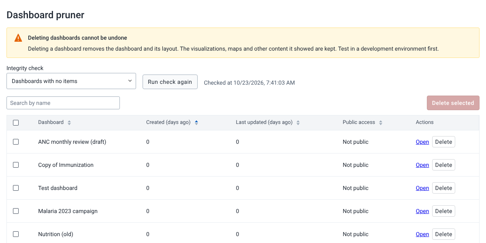
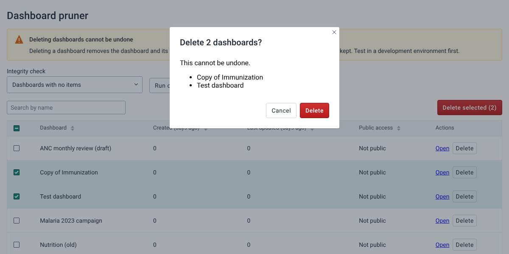

# Dashboard Pruner Tool { #tool-dashboard-pruner-overview }

## What the tool is for { #tool-dashboard-pruner-about }

The Dashboard Pruner Tool finds dashboards that have no items, or that nobody has opened in the last year, and lets you delete them. It is for system administrators who want to clean up the list of dashboards in a DHIS2 instance.

The tool uses two of the DHIS2 data integrity checks to find the dashboards. When you delete a dashboard, DHIS2 removes the dashboard and its layout. The visualizations, maps and other items that the dashboard showed are kept.

## Before you start { #tool-dashboard-pruner-before-you-start }

The tool works with DHIS2 2.40 and later.

To use the tool, you need one of the following:

- The **ALL** authority (superuser).
- The **Perform maintenance tasks** authority (`F_PERFORM_MAINTENANCE`), together with the authority that opens the app (`M_tooldashboardpruner`).

A superuser sees every dashboard that a check finds. Other users only see the dashboards that they can delete, that is, the dashboards shared with them with edit access.

> **Warning**
>
> You cannot undo a delete. Try the tool on a copy of your database first, and check the list of dashboards before you delete them.

## Install the tool { #tool-dashboard-pruner-install }

The tool is not on the App Hub. You can install it in two ways.

To install it from GitHub:

1. Open the [releases page of the tool](https://github.com/dhis2-utils/tool-dashboard-pruner/releases).
2. Download the `.zip` file of the newest release.
3. In DHIS2, open the **App Management** app.
4. In the sidebar, click **Manual install**.
5. Click **Upload an app to install**, and choose the file that you downloaded.

<!-- VERIFY IN APP: App Management labels on 2.40 to 2.43 -->

You can also install it from the tool-box app, which lists the DHIS2 tools from the HISP Centre.

If you have version 1.0.0 or earlier installed, the new version installs as a separate app. Uninstall the old **Dashboard Pruner Tool** in the **App Management** app, and add the new app to the user roles that gave access to the old one.

## Find dashboards to delete { #tool-dashboard-pruner-find }

When you open the tool, it runs the **Dashboards with no items** check and lists the dashboards that the check finds.

To change the check:

1. In the **Integrity check** menu, choose one of the checks:
    - **Dashboards with no items**: dashboards that show nothing.
    - **Dashboards not viewed in one year**: dashboards that nobody opened in the Dashboard app in the last year.
2. Wait for the check to finish. On a large database, this can take a few minutes.

The table shows, for each dashboard, how many days ago it was created and last updated, and if the public can view or edit it. For the **Dashboards not viewed in one year** check, the **Last viewed (days ago)** column shows **Never** for a dashboard that nobody has opened.

To narrow the list, enter part of a dashboard name in **Search by name**.

To look at a dashboard before you delete it, click **Open** in its row. The dashboard opens in the Dashboard app, in a new tab.

## Keep a dashboard that the check finds { #tool-dashboard-pruner-keep }

The **Dashboards not viewed in one year** check counts a view only when a user opens the dashboard in the Dashboard app. A dashboard that DHIS2 shows by itself, such as the dashboard that opens after login, does not count.

To keep a dashboard off this list:

1. Click **Open** in the row of the dashboard. The dashboard opens in the Dashboard app.
2. In the tool, click **Run check again**.

The dashboard is no longer in the list.

## Delete dashboards { #tool-dashboard-pruner-delete }

> **Warning**
>
> A deleted dashboard is gone for every user. You cannot undo the delete.

To delete one dashboard:

1. Click **Delete** in the row of the dashboard.
2. Check the name of the dashboard in the confirmation dialog.
3. Click **Delete**.

To delete several dashboards:

1. Choose the checkbox of each dashboard. To choose all dashboards that match the search, choose the checkbox in the table header.
2. Click **Delete selected**.
3. Check the list of dashboards in the confirmation dialog.
4. Click **Delete**.

The tool shows how many dashboards it deleted, and runs the check again. If a dashboard could not be deleted, the tool says why, and the dashboard stays chosen so that you can try again.

## Known limitations { #tool-dashboard-pruner-limitations }

- The time limit of one year comes from the DHIS2 check. You cannot change it.
- In DHIS2 2.42 and earlier, you cannot delete a dashboard that a push analysis uses. The tool marks these dashboards and names the push analysis. Delete the push analysis first. Push analysis was removed in DHIS2 2.43.
- A user who is not a superuser only sees the dashboards that are shared with them with edit access. The check itself finds all dashboards.
- The tool waits up to five minutes for a check to finish. On a very large database, the check can take longer, and the tool then shows an error. Click **Run check again** to try again.
- In DHIS2 2.40 and 2.41, the tool reads each dashboard that is not shared with the superuser one at a time. With many such dashboards, loading the list is slow.
- The tool deletes only the dashboard. It does not delete the visualizations, maps or other items that the dashboard showed, even if no other dashboard uses them.
